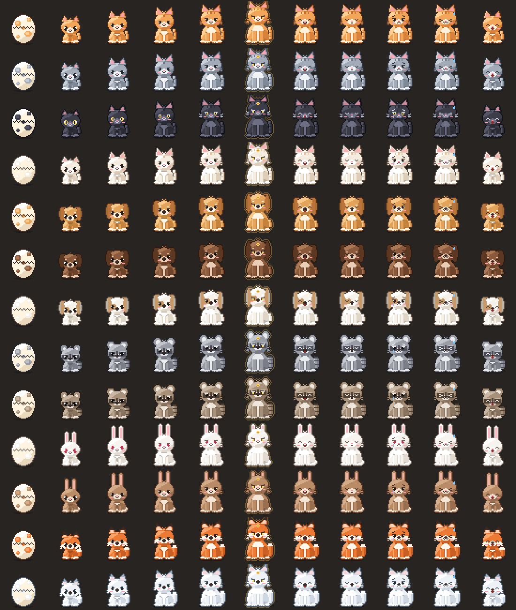
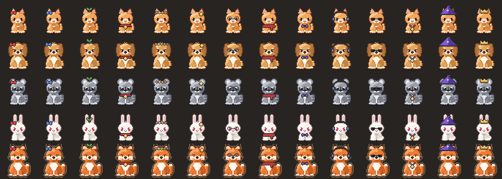
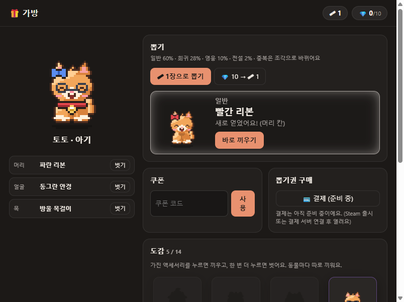

# UsagePet

Claude 사용량을 보여 주는 데스크톱 위젯 + 사용량을 먹고 자라는 펫이에요.

## ⬇️ 다운로드

**[최신 버전 받기 (Releases)](../../releases/latest)**

| 운영체제 | 받을 파일 |
|---|---|
| Windows 10/11 (64비트) | `UsagePet-Setup-x.x.x.exe` (설치) · `UsagePet-x.x.x-portable.exe` (설치 없이 실행) |
| macOS (Apple Silicon·Intel) | `UsagePet-x.x.x-mac.dmg` · `UsagePet-x.x.x-universal-mac.zip` |

### 필요한 것

- 그 PC에서 **Claude Code에 로그인**돼 있어야 해요. 터미널에서 `claude`를 실행하면 돼요.
- 앱은 Claude Code의 로그인 정보를 **읽기만** 해요. 바꾸거나 다른 곳으로 보내지 않아요. 사용량 조회는 Anthropic 서버로만 해요.

### 처음 실행할 때

- **Windows**: "Windows의 PC 보호" 경고가 뜨면 **추가 정보 → 실행**을 눌러요. 코드 서명이 없어서 그래요.
- **macOS**: 응용 프로그램 폴더로 옮긴 뒤 **우클릭 → 열기 → 열기**를 눌러요.
  - "손상되었기 때문에 열 수 없습니다"가 뜨면 터미널에서 `xattr -cr /Applications/UsagePet.app`을 실행해요.
  - "키체인 접근" 창이 뜨면 **항상 허용**을 눌러요.
- **같이 놀기**에서 처음 방을 만들면 방화벽 허용 창이 뜰 수 있어요.

## ✨ 기능

- **사용량 위젯**
  - 5시간 세션, 주간, 모델별 주간 한도, 크레딧을 보여 줘요.
  - 리셋까지 남은 시간과 한도 도달 예상 시각도 보여 줘요.
  - 80%와 90%에서 알림이 와요.
- **스마트 동기화**: Claude Code를 쓰는 중에는 1분마다, 쉴 때는 15분 이상 간격으로 조회해요.
- **펫 키우기**
  - Claude를 쓴 만큼 밥을 먹고 자라요.
  - 알 → 아기 → 청년 → 어른 → 현자 → 원로 순으로 자라요.
  - 오래 안 쓰면 배고파해요.
- **일러스트 (기본)**: 토끼, 여우, 라쿤, 삼색 고양이, 강아지가 단계마다 소품을 들고 나와요. 원로가 되면 배경 장면 전체가 펼쳐져요. 동물마다 따로 키워요.

  

- **픽셀 스킨**: 48×48 픽셀 동물 5종, 털색 13가지도 고를 수 있어요(트레이 → 펫 스킨).

  

- **가방 (뽑기·꾸미기)**: 액세서리 14종을 뽑기로 얻어서 머리, 얼굴, 목에 끼워요. 일러스트에서는 장면 모서리에 아이콘으로 보여요.

  
  

- **같이 놀기**
  - 토론방, 사냥방(협동 보스전), PvP(1:1 턴제)가 있어요.
  - 같은 와이파이면 바로 연결돼요. 인터넷 너머 친구와는 포트포워딩이나 VPN(예: Tailscale)이 필요해요.
  - 같은 버전끼리만 같은 방에 들어갈 수 있어요.

## 알아 두실 점

- 사용량 조회 API는 공개 문서가 없는 API라 예고 없이 바뀔 수 있어요.
- Claude Code 밖의 다른 AI 서비스에서 쓴 Claude 사용량은 표시되지 않아요.
- 결제는 아직 준비 중이에요.

이 저장소는 배포 전용이에요. 버그나 제안은 Issues에 남겨 주세요.
